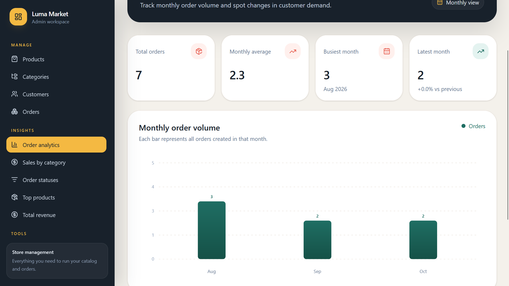
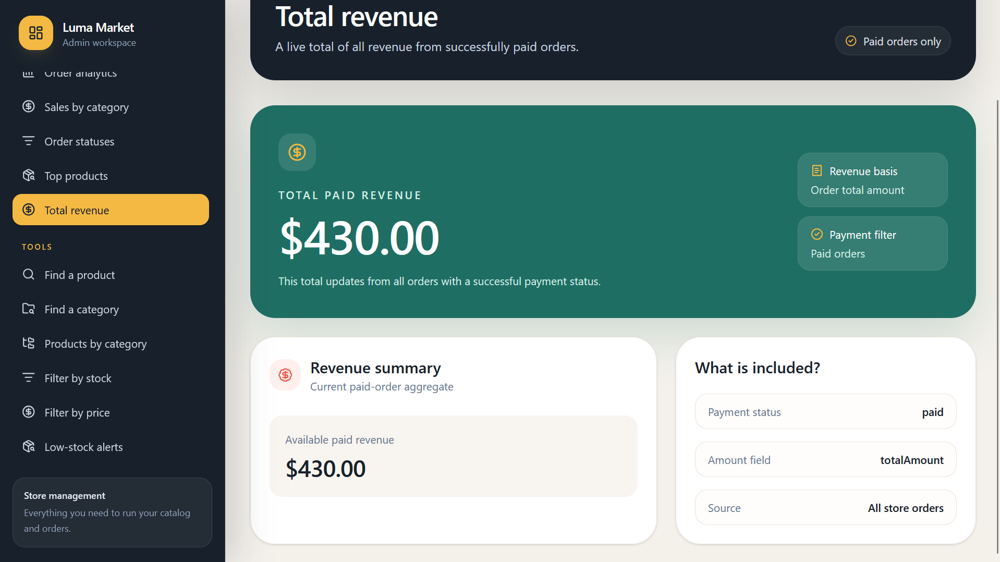
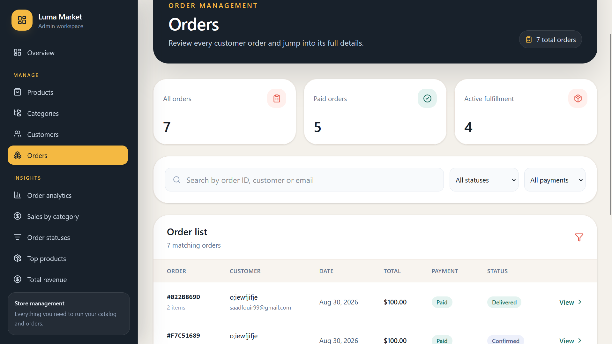
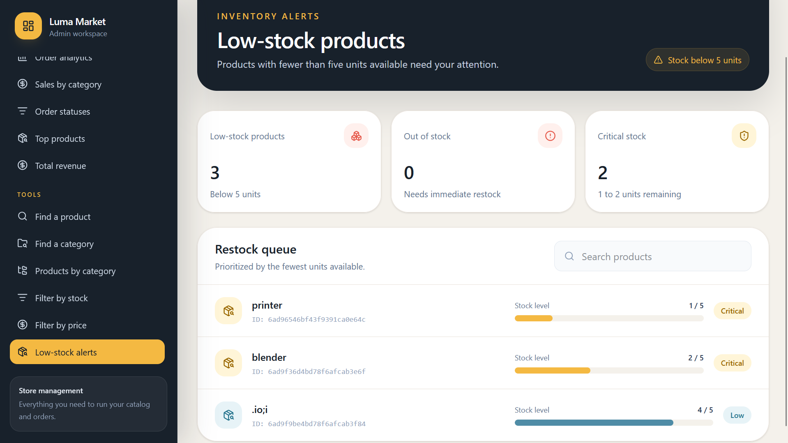
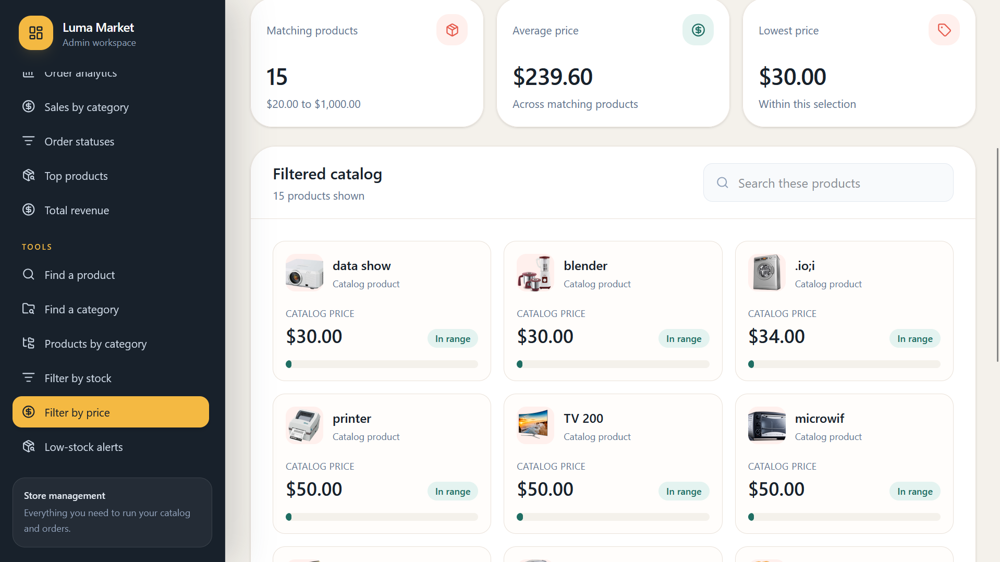
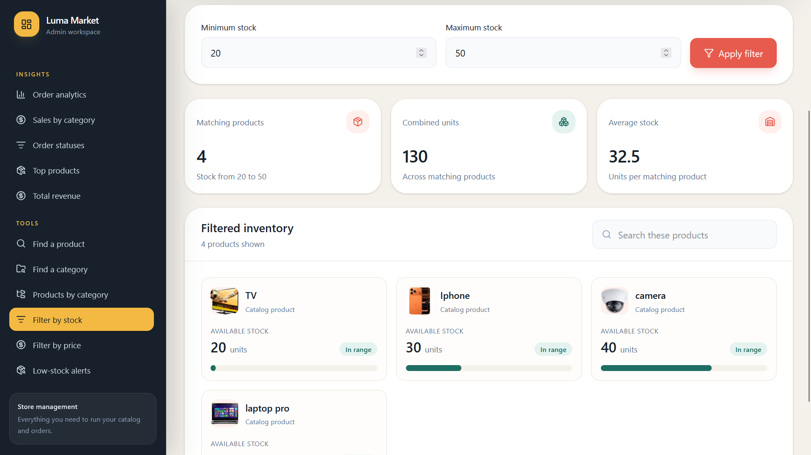

# Luma Market

Luma Market is a full-stack e-commerce application for browsing products, managing a shopping cart, and completing payments online. It includes a separate admin area for managing the store and reviewing sales and order analytics.

## Screenshots

### Store administration

| Sales overview | Revenue |
| --- | --- |
|  |  |

| Orders | Low-stock alerts |
| --- | --- |
|  |  |

| Filter by price | Filter by stock |
| --- | --- |
|  |  |

## Core features

- **Online storefront:** Browse the product catalog, view product details, and explore promotional banners.
- **Customer accounts:** Register, verify an email address, and sign in.
- **Shopping cart:** Add products, adjust the cart by removing items, and clear the cart.
- **Payments and orders:** Complete checkout using Stripe and view order/payment outcomes.
- **Store administration:** Manage products, categories, customers, and orders.
- **Inventory tools:** Find products by name, category, price, or stock level, and monitor low-stock items.
- **Analytics dashboard:** Review revenue, sales by category, order trends, best-selling products, and top customers.

## Tech stack

- **Frontend:** React, Vite, React Router, Tailwind CSS, and Stripe Elements
- **Backend:** Node.js, Express, and Mongoose
- **Data and services:** MongoDB, Cloudinary, Stripe, and Nodemailer

## Getting started

### Requirements

- Node.js and npm
- A MongoDB database
- Cloudinary credentials for product and avatar image uploads
- Stripe API keys for checkout
- An email account or SMTP credentials for email verification

### Configure the backend

Create `backend/.env` and set the values for your services:

```dotenv
PORT=5000
NODE_ENV=development
MONGO_URI=mongodb://127.0.0.1:27017/luma-market

ACCESS_TOKEN_SECRET=replace-with-a-long-random-secret
ACCESS_TOKEN_EXPIRES=1h
REFRESH_TOKEN_SECRET=replace-with-another-long-random-secret
REFRESH_TOKEN_EXPIRES=7d

ADMIN_USERNAME=your-admin-username
ADMIN_PASSWORD=your-admin-password

CLOUDINARY_CLOUD_NAME=your-cloud-name
CLOUDINARY_API_KEY=your-cloudinary-api-key
CLOUDINARY_API_SECRET=your-cloudinary-api-secret

STRIPE_SECRET_KEY=sk_test_your-secret-key
STRIPE_WEBHOOK_SECRET=whsec_your-webhook-secret

EMAIL_USER=your-email-address
EMAIL_PASSWORD=your-email-or-app-password
```

Use your own values and keep `.env` files and secrets out of source control. Configure a Stripe webhook to deliver payment events to `http://localhost:5000/api/stripe/webhook`; use its signing secret for `STRIPE_WEBHOOK_SECRET`.

### Configure the frontend

Create `frontend/.env.local` and add your Stripe publishable key:

```dotenv
VITE_STRIPE_PUBLISHABLE_KEY=pk_test_your-publishable-key
```

The Vite development server proxies `/api` requests to `http://localhost:5000`. If you host the API elsewhere, set `VITE_API_URL` to the API base URL, such as `https://api.example.com/api`.

### Install and run

In one terminal, install and start the backend:

```powershell
cd backend
npm install
npm run dev
```

In a second terminal, install and start the frontend:

```powershell
cd frontend
npm install
npm run dev
```

Open the local URL printed by Vite (typically `http://localhost:5173`). The backend listens on the port configured by `PORT` (typically `http://localhost:5000`).

## Useful commands

Run these from the corresponding `backend` or `frontend` directory:

| Command | Purpose |
| --- | --- |
| `npm run dev` | Start the development server |
| `npm run build` | Build the frontend for production |
| `npm run lint` | Lint the frontend |
| `npm start` | Start the backend |
